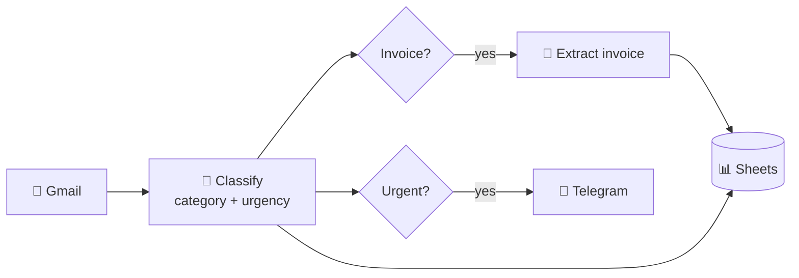

# 📬 AI Inbox Automation

**An LLM that reads a company inbox so people don't have to.**
It classifies every email, extracts invoice data, alerts on urgent messages and logs everything to Google Sheets.


## ✨ Highlights

- **End-to-end workflow:** Gmail → LLM classification → invoice extraction → Telegram alerts → Google Sheets
- **Reliable structured outputs:** function calling + Pydantic validation, with automatic self-correction
- **Measured, not guessed:** 92% classification accuracy (dev set), 76% on a held-out test set; invoice extraction improved from **50% → 83%**
- **Real debugging:** found that the self-correction loop was *causing* hallucinations, by inspecting raw model outputs, and fixed it
- **Runs fully local** with Ollama, and switches to Gemini or OpenAI by editing `.env`

## ⚙️ How it works



**n8n** handles the plumbing (triggers, routing, integrations). A **FastAPI** service handles the AI: it calls the LLM, forces a structured answer and validates it.

## 🧠 Key technical decisions

| Decision | Why |
|---|---|
| **Function calling + Pydantic** | The model must answer through a typed schema, so it can't reply in free text or invent categories. |
| **Validation with self-correction** | Invalid answers are sent back to the model with the error, up to 3 attempts. |
| **Required but nullable fields** | Missing data must be an explicit `null`, never silently skipped or invented. |
| **Temperature 0 + fixed seed** | Same email, same result, so evaluation runs are comparable. |
| **Provider-agnostic client** | Built after hitting Gemini's free-tier limits; switching to a local model only needed `.env`. |

> 💡 **Lesson learned:** when the model correctly left out a missing due date, the "please fix" retry pushed it to *invent* one. Telling the retry to use `null` for missing values fixed it across all cases.

## 📊 Evaluation

| Task | Dataset | Result |
|---|---|---|
| Classification | 24 dev emails | **92%** category + urgency correct |
| Classification | 17 held-out emails | **76%** (urgency 94%) |
| Invoice extraction | 6 invoices | **50% → 83%** all fields correct |

<details>
<summary>How the scores improved</summary>

**Classification (dev set, both correct):** baseline 71% → concrete urgency examples 83% → one more example 88%. Tuning stopped when a fix caused a regression, a sign of overfitting.

**Extraction (all fields correct):** baseline 50% → retry asks for explicit `null` 67% → placeholder-to-`null` validator 83%.

Every run is saved in `results/`.
</details>

## ⚠️ Known limitations

- The 7B model **miscalculates relative dates** ("pay by tomorrow"). Planned fix: the LLM extracts dates as written and Python resolves them, because the LLM reads well but calculates poorly.
- Datasets are **small and written by one person**; extraction has no held-out set yet.
- Gmail is **polled every minute**, not pushed.

## 🚀 Quick start

```bash
python -m venv .venv && .venv\Scripts\Activate.ps1
pip install -r requirements.txt
ollama pull qwen2.5:7b
cp .env.example .env

uvicorn src.api:app --reload --port 8000   # API, docs at /docs
n8n start                                  # then import n8n/ai-inbox-workflow.json
```

<details>
<summary>Connecting Gmail, Sheets and Telegram</summary>

- **Gmail + Sheets:** create a Google Cloud project, enable the Gmail, Sheets and Drive APIs, set the OAuth app to *External / Testing*, add yourself as a test user, and create a *Web application* client with the redirect URI shown in n8n.
- **Telegram:** create a bot with @BotFather and get your chat ID from `https://api.telegram.org/bot<TOKEN>/getUpdates`.
- **Sheets log:** one spreadsheet with an `Emails` tab and an `Invoices` tab (column names in the workflow).
- In n8n, call the API at `http://127.0.0.1:8000`, not `localhost` (Node.js may resolve it to IPv6).
</details>

<details>
<summary>Run the evaluations</summary>

```bash
python -m src.evaluate                           # classification, dev set
python -m src.evaluate data/test_emails.json     # classification, held-out set
python -m src.evaluate_extraction                # invoice extraction
```
</details>

## 🗺️ Roadmap

- [x] Classification and extraction with structured outputs
- [x] Evaluation with dev and held-out sets
- [x] Gmail trigger, Telegram alerts, Google Sheets log
- [ ] Deterministic date resolution (LLM extracts, code computes)
- [ ] Held-out set for extraction
- [ ] Compare with a larger model