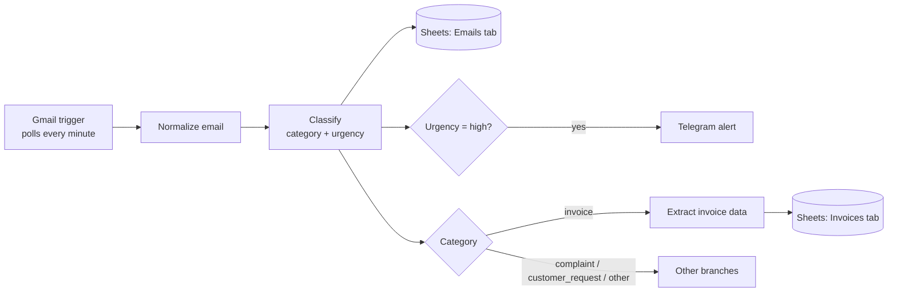

# ai-inbox-automation

LLM-powered email workflow: reads a Gmail inbox, classifies every message,
extracts invoice data, alerts on urgent emails and logs everything to Google
Sheets. Built with n8n, Python, FastAPI and a local LLM (Ollama).

## The problem

Small companies lose hours every week reading their shared inbox by hand:
copying invoice data into spreadsheets, forwarding customer requests and
noticing too late that an angry customer threatened to cancel.

This project automates that triage. Every email is classified by type and
urgency, invoice data is extracted into a structured format, urgent emails
trigger a Telegram alert, and both emails and invoices are logged to a
spreadsheet.

## How it works



The work is split between two tools, each doing what it does best:

- **n8n** orchestrates the workflow: the Gmail trigger, routing, the Telegram
  alert and the Google Sheets log.
- **A Python service (FastAPI)** does the AI work: it calls the LLM, enforces
  structured outputs and validates every answer.

| Endpoint | Method | What it does |
|---|---|---|
| `/health` | GET | Checks that the service is running |
| `/classify` | POST | Returns `category`, `urgency` and a short `reason` |
| `/extract-invoice` | POST | Returns supplier, invoice number, invoice and due dates, total, currency and category |

A `Normalize email` node maps the Gmail message to a fixed shape (`from`,
`subject`, `body`, `received_at`), so the rest of the workflow does not depend
on where the email came from.

## Technical decisions

- **Structured outputs via function calling.** Each answer is defined as a
  Pydantic model, converted to a JSON Schema and given to the LLM as a tool it
  is forced to call (`tool_choice="required"`). The model cannot answer in
  free text or invent new categories (`Literal` types).
- **Validation and self-correction.** Every answer is validated with Pydantic.
  If it is invalid, the validation error is sent back to the model so it can
  fix its answer (up to 3 attempts).
- **Reproducible results.** Temperature 0 and a fixed seed, so the same email
  gets the same result and evaluation runs can be compared fairly.
- **Provider-agnostic LLM layer.** The service uses the OpenAI SDK against any
  OpenAI-compatible endpoint, so switching between a local model (Ollama),
  Gemini or OpenAI only requires changing `.env`. This came from a real need:
  the Gemini free tier hit a 20-requests-per-day limit and overload errors
  (503) during development.
- **Resilience.** API requests have a timeout and automatic retries with
  exponential backoff, and the n8n HTTP and Telegram nodes retry on failure,
  so a slow or overloaded service fails clearly instead of hanging the
  pipeline.
- **No invented data.** Fields that may be missing (supplier, invoice number,
  dates) are *required but nullable*: the model must always write them, either
  with a value or with an explicit `null`. A validator also turns placeholder
  answers such as `"null"` or `"Unknown Supplier"` into a real `null`.
- **Retry feedback that does not cause hallucinations.** Debugging the raw
  model output showed that the self-correction loop was creating errors: when
  the model correctly left out a missing due date, the "please fix" message
  pushed it to invent one (it used the date the email was received). The
  retry message now says explicitly to use `null` for values that are not in
  the text, which fixed it for every model output, not just one example.
- **Secrets stay out of the repo.** OAuth client secrets and the Telegram bot
  token live in n8n's credential store and `.env`; the exported workflow only
  references credentials by name.

## Evaluation

All evaluations use `qwen2.5:7b` running locally via Ollama. Full results of
every run are saved in `results/`.

### Classification

The classifier was developed on 24 labelled emails (`data/sample_emails.json`)
and evaluated once on 17 held-out emails (`data/test_emails.json`) that were
not used while tuning the prompt. About 1.5 s per email on a laptop.

Run it with `python -m src.evaluate` (development set) or
`python -m src.evaluate data/test_emails.json` (test set).

#### Development set (prompt iterations)

| Version | Category | Urgency | Both |
|---|---|---|---|
| Baseline | 96% | 75% | 71% |
| A: reason field before the decision | 96% | 71% | 67% |
| B: concrete urgency examples in the prompt | 96% | 88% | 83% |
| C: B + example for angry emails without a deadline | 96% | 92% | 88% |

- **A** had no measurable effect on its own: the model used the reasoning
  space to discuss the category, never the urgency rules. It was kept in the
  final version, as it did not hurt results.
- **B** fixed the cases where abstract rules were ignored (e.g. long payment
  deadlines). Small models follow concrete examples much better than rules.
- **C** fixed two cases but introduced a regression (feedback marked "no need
  to reply" became medium urgency), a sign of overfitting to the development
  set, so tuning stopped here.
- Removing the explicit rule "a payment reminder is an invoice" did not change
  the result, because the category definition already covered overdue
  notices. The rule was kept for robustness with other models.

With the fixed seed added later, version C scores 96% / 96% / 92% on the
development set.

#### Held-out test set (final result)

| Category | Urgency | Both |
|---|---|---|
| 82% | 94% | 76% |

Urgency generalised well. Category accuracy dropped from 96% to 82%: two of
the three errors are genuinely ambiguous emails (a duplicate charge, a late
delivery), and one is a clear error where positive feedback was classified
as a complaint. In one case the model's reasoning mentioned "an order that
has not shipped yet", which was not in the email: the prompt examples can
bias the model towards familiar patterns.

### Invoice extraction

Extraction is evaluated field by field on `data/sample_invoices.json`: small
invoices and reminder emails, each designed to test one difficulty (an amount
called "Total due" with no deadline, no supplier, a missing year, two dates,
a non-EUR currency, a Portuguese invoice with `dd/mm/yyyy` dates and a
decimal comma). Harmless formatting differences (`#4521` vs `4521`) count as
correct.

Run it with `python -m src.evaluate_extraction`.

| Version (6 invoices) | All fields correct |
|---|---|
| Baseline: separate invoice/due dates, invoice number, required-nullable fields | 50% |
| + category descriptions and clearer date descriptions | 50% |
| + retry feedback asks for explicit `null` instead of a fix | 67% |
| + placeholder-to-`null` validator | 83% |

The second step fixed the category errors but showed no overall gain:
the model now omitted the due date, the retry asked it to "fix" that, and it
invented one. Looking at the raw tool-call arguments, not just the final
score, is what revealed this.

A seventh case with a relative date ("must be paid by tomorrow") was then
added on purpose, bringing the score to **71% (5 of 7)**. The remaining
errors are described below.

## Known limitations

- **Relative and implied dates.** The 7B model miscalculates relative dates
  ("pay by tomorrow" became the received date instead of the next day) and
  infers an invoice date from reminder emails that only mention a due date.
  Both cases are tracked in the eval set. A planned fix is to have the LLM
  extract dates *as written* and resolve them deterministically in Python:
  the LLM reads well but calculates poorly.
- **Small datasets.** Each email is about 6 percentage points on the
  classification test set, and each invoice about 14 points on the
  extraction set. All examples were written by the same author, so real
  emails may be more varied.
- **No held-out set for extraction yet.** The extraction set was used while
  improving the prompt, so its score is optimistic.
- **Gmail polling, not push.** The n8n Gmail trigger checks for new emails
  every minute. Real-time push would need the Gmail `watch` API with Google
  Pub/Sub calling a webhook.
- **OAuth in testing mode.** The Google Cloud app is in "Testing" status, so
  the Gmail and Sheets logins expire every 7 days and must be renewed in n8n.

## Project structure

```
src/
  llm.py                 # provider-agnostic LLM client + structured output helper
  classification.py      # email category and urgency
  extraction.py          # invoice data extraction
  evaluate.py            # classification evaluation
  evaluate_extraction.py # field-by-field extraction evaluation
  api.py                 # FastAPI service used by n8n
data/
  sample_emails.json     # classification development set (24 emails)
  test_emails.json       # classification held-out test set (17 emails)
  sample_invoices.json   # extraction evaluation set (7 cases)
n8n/
  ai-inbox-workflow.json # exported n8n workflow
results/                 # saved evaluation runs
```

## Running locally

Requirements: Python 3.10+, [Ollama](https://ollama.com), Node.js 24 LTS.

```bash
# 1. Python environment
python -m venv .venv
.venv\Scripts\Activate.ps1        # Windows PowerShell (Linux/macOS: source .venv/bin/activate)
pip install -r requirements.txt

# 2. Local LLM
ollama pull qwen2.5:7b
cp .env.example .env              # Ollama settings are in .env.example

# 3. Try it
python -m src.classification
python -m src.extraction
python -m src.evaluate
python -m src.evaluate_extraction

# 4. Start the API (docs at http://127.0.0.1:8000/docs)
uvicorn src.api:app --reload --port 8000

# 5. Start n8n and import n8n/ai-inbox-workflow.json
npm install -g n8n
n8n start
```

Note: in n8n, call the API at `http://127.0.0.1:8000` rather than
`localhost`, because recent Node.js versions may resolve `localhost` to IPv6.

### Connecting the integrations

The imported workflow needs three credentials in n8n:

- **Gmail and Google Sheets (OAuth2).** Create a Google Cloud project, enable
  the Gmail, Sheets and Drive APIs, set the OAuth app to *External / Testing*
  and add your account as a test user. Create a *Web application* OAuth
  client with the redirect URI shown in n8n
  (`http://localhost:5678/rest/oauth2-credential/callback`). The Gmail trigger
  only reads emails sent to a `+aiinbox` address, so the rest of the inbox is
  left alone.
- **Telegram.** Create a bot with @BotFather and use its token; get your chat
  ID by messaging the bot and opening `https://api.telegram.org/bot<TOKEN>/getUpdates`.
- **Google Sheets log.** Create a spreadsheet with an `Emails` tab
  (`received_at, from, subject, category, urgency, reason`) and an `Invoices`
  tab (`received_at, from, subject, supplier, invoice_number, invoice_date,
  due_date, total_amount, currency, category`).

## Roadmap

- [x] Email classification and invoice extraction with structured outputs
- [x] Evaluation with development and held-out test sets
- [x] FastAPI service and n8n workflow
- [x] Telegram alert for high-urgency emails
- [x] Gmail trigger (OAuth) instead of a test email
- [x] Log emails and invoices to Google Sheets
- [x] Field-by-field evaluation for invoice extraction
- [ ] Resolve dates deterministically in Python (LLM extracts, code computes)
- [ ] Held-out test set for extraction
- [ ] Compare with a larger model (e.g. `qwen2.5:14b`)