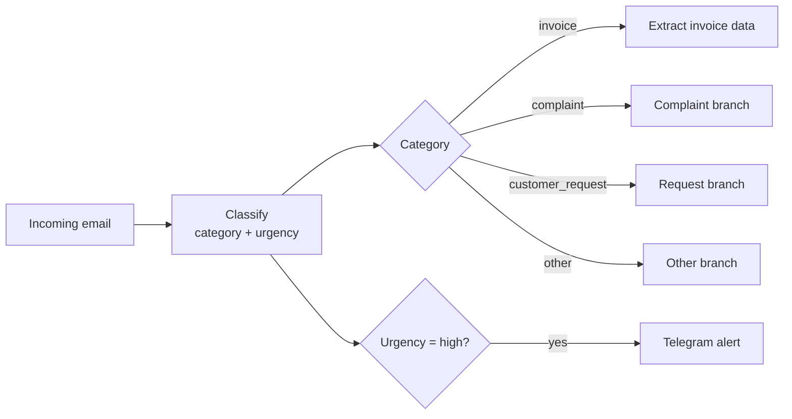

# ai-inbox-automation

LLM-powered email workflow: classifies incoming messages, extracts invoice data
and routes them, built with n8n, Python, FastAPI and a local LLM (Ollama).

## The problem

Small companies lose hours every week reading their shared inbox by hand:
copying invoice data into spreadsheets, forwarding customer requests and
noticing too late that an angry customer threatened to cancel.

This project automates that triage. Every email is classified by type and
urgency, invoice data is extracted into a structured format, and urgent
emails trigger an alert.

## How it works



The work is split between two tools, each doing what it does best:

- **n8n** orchestrates the workflow: triggers, routing, integrations and alerts.
- **A Python service (FastAPI)** does the AI work: it calls the LLM, enforces
  structured outputs and validates every answer.

| Endpoint | Method | What it does |
|---|---|---|
| `/health` | GET | Checks that the service is running |
| `/classify` | POST | Returns `category`, `urgency` and a short `reason` |
| `/extract-invoice` | POST | Returns supplier, date, total, currency and category |

## Technical decisions

- **Structured outputs via function calling.** Each answer is defined as a
  Pydantic model, converted to a JSON Schema and given to the LLM as a tool it
  is forced to call (`tool_choice="required"`). The model cannot answer in
  free text or invent new categories (`Literal` types).
- **Validation and self-correction.** Every answer is validated with Pydantic.
  If it is invalid, the validation error is sent back to the model so it can
  fix its answer (up to 3 attempts).
- **Temperature 0** for classification and extraction: the same email should
  always get the same result.
- **Provider-agnostic LLM layer.** The service uses the OpenAI SDK against any
  OpenAI-compatible endpoint, so switching between a local model (Ollama),
  Gemini or OpenAI only requires changing `.env`. This came from a real need:
  the Gemini free tier hit a 20-requests-per-day limit and overload errors
  (503) during development.
- **Resilience.** Requests have a timeout and automatic retries with
  exponential backoff, so a slow or overloaded provider fails clearly instead
  of hanging the pipeline.
- **No invented data.** Early tests showed the model inventing a supplier
  ("Unknown Supplier") and guessing the year of dates written without one.
  Fixed by making the supplier optional (`null` when not stated), forbidding
  invented values in the prompt, and passing today's date to the model.

## Evaluation

The classifier was developed on 24 labelled emails (`data/sample_emails.json`)
and evaluated once on 17 held-out emails (`data/test_emails.json`) that were
not used while tuning the prompt. Model: `qwen2.5:7b` running locally via
Ollama, about 1.5 s per email on a laptop.

Run it with `python -m src.evaluate` (development set) or
`python -m src.evaluate data/test_emails.json` (test set). Full results are
saved in `results/`.

### Development set (prompt iterations)

| Version | Category | Urgency | Both |
|---|---|---|---|
| Baseline | 96% | 75% | 71% |
| A: reason field before the decision | 96% | 71% | 67% |
| B: concrete urgency examples in the prompt | 96% | 88% | 83% |
| C: B + example for angry emails without a deadline | 96% | 92% | 88% |

- **A** had no measurable effect on its own: the model used the reasoning
  space to discuss the category, never the urgency rules. It was kept in the
  final version, as it did not hurt results.
- **B** fixed the cases where abstract rules were ignored (e.g. long payment
  deadlines). Small models follow concrete examples much better than rules.
- **C** fixed two cases but introduced a regression (feedback marked "no need
  to reply" became medium urgency), a sign of overfitting to the development
  set, so tuning stopped here.
- Removing the explicit rule "a payment reminder is an invoice" did not change
  the result, because the category definition already covered overdue
  notices. The rule was kept for robustness with other models.

### Held-out test set (final result)

| Category | Urgency | Both |
|---|---|---|
| 82% | 94% | 76% |

Urgency generalised well. Category accuracy dropped from 96% to 82%: two of
the three errors are genuinely ambiguous emails (a duplicate charge, a late
delivery), and one is a clear error where positive feedback was classified
as a complaint. In one case the model's reasoning mentioned "an order that
has not shipped yet", which was not in the email: the prompt examples can
bias the model towards familiar patterns.

**Limitations:** both datasets are small (each email is about 6 percentage
points on the test set) and were written by the same author, so real emails
may be more varied.

## Project structure

```
src/
  llm.py             # provider-agnostic LLM client + structured output helper
  classification.py  # email category and urgency
  extraction.py      # invoice data extraction
  evaluate.py        # evaluation script
  api.py             # FastAPI service used by n8n
data/
  sample_emails.json # development set (24 emails)
  test_emails.json   # held-out test set (17 emails)
n8n/
  ai-inbox-workflow.json  # exported n8n workflow
results/             # saved evaluation runs
```

## Running locally

Requirements: Python 3.10+, [Ollama](https://ollama.com), Node.js 24 LTS.

```bash
# 1. Python environment
python -m venv .venv
.venv\Scripts\Activate.ps1        # Windows PowerShell (Linux/macOS: source .venv/bin/activate)
pip install -r requirements.txt

# 2. Local LLM
ollama pull qwen2.5:7b
cp .env.example .env              # Ollama settings are in .env.example

# 3. Try it
python -m src.classification
python -m src.evaluate

# 4. Start the API (docs at http://127.0.0.1:8000/docs)
uvicorn src.api:app --reload --port 8000

# 5. Start n8n and import n8n/ai-inbox-workflow.json
npm install -g n8n
n8n start
```

Note: in n8n, call the API at `http://127.0.0.1:8000` rather than
`localhost`, because recent Node.js versions may resolve `localhost` to IPv6.

## Roadmap

- [x] Email classification and invoice extraction with structured outputs
- [x] Evaluation with development and held-out test sets
- [x] FastAPI service and n8n workflow
- [ ] Telegram alert for high-urgency emails (in progress)
- [ ] Save extracted invoices to Google Sheets (OAuth)
- [ ] Replace the test email with a Gmail trigger (OAuth)
